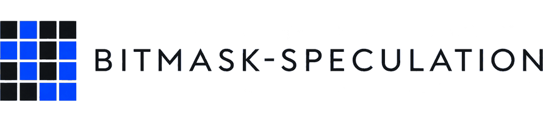

<div align="center">


[](https://opensource.org/licenses/MIT)
[](https://www.python.org/downloads/)
[](https://developer.nvidia.com/cuda-toolkit)
[](https://triton-lang.org/)
</div>

This work makes speculative decoding hold up under JSON-schema constraints. The
draft model proposes only tokens the grammar allows, a popcount over that same
packed token mask decides how far to speculate, and CUDA and Triton kernels carry
out the masked selection. Because every proposal is verified against the target,
the output stays token-for-token identical to grammar-constrained greedy
decoding. The gains concentrate where a schema leaves the fewest choices: on an
A100, density-scheduled speculation runs up to **2.73×** faster than fixed-budget
speculation on enum-dominated schemas.

---

## Why structured output stalls speculative decoding

Speculative decoding lets a small draft model propose K tokens that the target
model verifies in a single forward pass; every accepted token saves a target
forward. Structured generation adds a grammar mask at each step. An unconstrained
draft cannot see that mask, so it spends proposals on tokens the target is
forbidden to emit. Each one ends the round at a rejection, acceptance falls, and
the verification cost is no longer amortized.

## Approach

| Technique | Mechanism | Effect |
|---|---|---|
| **Grammar-constrained drafting** | The draft selects under a fork of the target's grammar state, discarded after verification | Every proposal is schema-valid, so rejections reflect model disagreement only |
| **Density-scheduled budget** | The fraction of valid vocabulary entries in the committed mask sets K for the round | Deep speculation where the schema dictates the next tokens, shallow where text is free |
| **Packed-mask kernels** | 32-bit mask words feed a fused count + masked argmax (CUDA, Triton) and an online-softmax sampler | Bit test, valid-token count and argmax complete in one pass over mask and logits |

Verification accepts the longest matching prefix, substitutes the target's token
at the first mismatch and emits a bonus token when every proposal is accepted, so
the output never depends on the draft. No training is involved; the scheduling
signal is computed from the mask the grammar already produces.

## Results

A100-SXM4 · Qwen3.5-4B target, Qwen3.5-0.8B draft · vocabulary 248,320 · FP16 ·
end-to-end decoding. C3 is grammar-constrained drafting at fixed K=5; C4 adds the
density schedule with K ≤ 8.

### Adaptive versus fixed speculation budget

| Schema | C3 acceptance | C4 acceptance | C4 / C3 throughput |
|---|:---:|:---:|:---:|
| Pure enum | 80% | 80% | **2.73×** |
| Nested enum (3 fields) | 100% | 100% | **1.64×** |
| Enum + short text | 85% | 92% | **1.62×** |
| Enum + text (mixed) | 95% | 95% | 1.15× |
| Long free text | 79% | 80% | 1.14× |
| Short free text | 92% | 85% | 0.96× |

Across the six schemas, aggregate throughput rises **1.35×** with acceptance
unchanged at about 88%. The gain concentrates where masks are sparse: enum-heavy
positions admit a handful of tokens, the draft cannot miss, and C4 speculates
eight deep where C3 stops at five. On free text the schedule falls back to K=1
and C4 converges to C3.

### Batched masked reduction

Verification needs a masked argmax at all K+1 positions of a round. The Triton
reduction fuses the bit test, the valid-token count and the argmax, and reduces
every position in one batched call:

| Rows (K+1) | Triton | PyTorch, per row | Speedup |
|:---:|:---:|:---:|:---:|
| 1 | 77 μs | 101 μs | 1.3× |
| 6 (K=5) | 83 μs | 649 μs | **7.8×** |
| 8 | 76 μs | 877 μs | 11.5× |
| 12 | 77 μs | 1,331 μs | 17.3× |

Latency is flat from 1 to 12 rows: each row occupies its own blocks across the
A100's 108 SMs, so additional verification positions add no wall time at this scale.

### CUDA kernels

| Kernel | Technique | Result |
|---|---|---|
| `popcount.cu` | `__popc` per mask word, warp-shuffle reduction | **111×** over the reference count |
| `argmax.cu` | Multi-block masked argmax: each lane loads one mask word, warps broadcast it with `__shfl_sync` while lanes read coalesced logits; `__popc` count fused in | 6× faster per call than Triton and 24× faster than PyTorch at 6 rows (A10G) |
| `sample.cu` | Online-softmax inverse-CDF sampling (Milakov & Gimelshein) | **5×** less memory traffic than mask → softmax → multinomial |

### Where decode time goes

An Nsight Systems trace of the same pipeline (A10G, Qwen3-4B / 0.6B, BF16) shows
Hugging Face eager execution issuing about 2,081 kernel launches per target
forward and 1,591 per draft forward. The GPU is busy for 15–38% of decode wall
time, and a 0.6B draft forward costs 77% of a 4B target forward in wall time but
23% in GPU time. Grammar work and masked selection together stay under 3%. The
mask path is no longer the bottleneck; per-forward launch overhead is, which makes
CUDA-graph capture of the draft and target forwards the next lever. Details are
in [benchmarks](docs/benchmarks.md#decode-profile).

## Getting started

Python 3.12+ on a Linux NVIDIA host:

```bash
pip install "bitmask-speculation[models,grammar,triton] @ git+https://github.com/karthikeyansura/bitmask-speculation"
```

```python
from bitmask_speculation import ModelSpec, TransformersEngine

engine = TransformersEngine.from_pretrained(
    ModelSpec("Qwen/Qwen3.5-4B", "851bf6e806efd8d0a36b00ddf55e13ccb7b8cd0a"),
    ModelSpec("Qwen/Qwen3.5-0.8B", "2fc06364715b967f1860aea9cf38778875588b17"),
)

result = engine.generate(
    "Call a function to search for AI news.",
    mode="c4",  # grammar-constrained draft + density-scheduled budget
    schema={
        "type": "object",
        "properties": {
            "function": {"type": "string", "enum": ["search", "get", "post"]},
            "query": {"type": "string"},
        },
        "required": ["function", "query"],
    },
    max_new_tokens=64,
)

print(result.text)               # {"function": "search", "query": ...}
print(result.acceptance_rate)    # accepted / verified draft tokens
print(result.tokens_per_second)  # device-synchronized decode throughput
```

The same request from the command line, with a one-line summary on stderr:

```bash
bitmask-speculation generate "Call a function to search for AI news." \
  --target Qwen/Qwen3.5-4B --target-revision 851bf6e806efd8d0a36b00ddf55e13ccb7b8cd0a \
  --draft Qwen/Qwen3.5-0.8B --draft-revision 2fc06364715b967f1860aea9cf38778875588b17 \
  --mode c4 --schema-file benchmarks/schemas/schema_tool_call.json --stats
```

Device, precision and backend default to the current CUDA device, bfloat16 and
the CUDA extension, falling back to Triton when no CUDA toolkit is present. Modes `target_constrained`, `c2` and
`c3` select the constrained baseline, target-only masking and fixed-K constrained
drafting.

## How the speculation budget adapts

Mask density changes position by position, and it predicts how constrained the
next tokens are before the draft runs:

```
{"function": "     only a few enum prefixes valid   density ≈ 0.001%   K = 8
"query": "lat      thousands of tokens valid        density ≈ 2%       K = 1
```

Before each round the scheduler counts the committed mask and applies three bands:

```
density < 0.005  →  K = 8    the schema dictates the continuation
density < 0.02   →  K = 4    moderately constrained
otherwise        →  K = 1    free text; the draft is likely to diverge
```

The signal is deterministic and needs no trained head and no smoothing window.
[SpecDec++](https://arxiv.org/abs/2405.18466) shows that the optimal speculation
length follows a threshold rule on acceptance probability; mask density is a
direct, model-free proxy for that probability under a grammar.

## Documentation

| Guide | Contents |
|---|---|
| [Usage](docs/usage.md) | Python API, CLI, decoding modes, termination, KV caching |
| [Design](docs/design.md) | Verification contract, worked prefix traces, accounting, scheduling |
| [Kernels](docs/kernels.md) | Tensor contracts, launch structure, streams and scratch ownership |
| [Benchmarks](docs/benchmarks.md) | Methodology, A10G decode study, kernel timing, decode profile |
| [Development](docs/development.md) | Installation, tests, distribution checks, sanitizers |

## License

MIT
