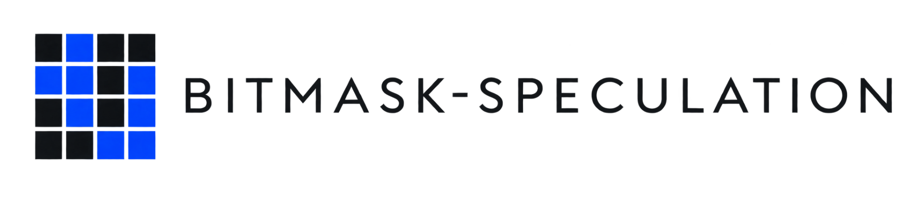

<div align="center">


[](https://opensource.org/licenses/MIT)
[](https://www.python.org/downloads/)
[](https://developer.nvidia.com/cuda-toolkit)
[](https://triton-lang.org/)
</div>

# bitmask-speculation

Packed grammar masks for draft scheduling and token verification in structured
LLM decoding. The project combines grammar-constrained draft proposals, ordered
prefix verification and density-based draft budgets, with standalone CUDA
primitives for popcount, masked argmax and categorical sampling.

A narrow grammar can reduce invalid proposals without making the draft agree
with the target. Mask density is a scheduling signal, not an acceptance guarantee;
its overhead and effect on throughput must be measured.

## Use

Python 3.12 or later. From this checkout:

```bash
uv sync --extra models --extra grammar
source .venv/bin/activate
bitmask-speculation generate --help
```

Generate from locally saved model/tokenizer directories:

```bash
bitmask-speculation generate 'Return a colour:' \
  --target /path/to/target --draft /path/to/draft \
  --mode c3 --schema-json '{"enum":["red","blue"]}' \
  --max-new-tokens 32 --local-files-only
```

For Hub models, provide full revision SHAs with `--target-revision` and
`--draft-revision`. Target and draft tokenizer definitions must match. Choose
`--device cuda --dtype bfloat16` on a compatible GPU host; CPU/float32 is the
default. Model loading never starts cloud resources.

The [Python API](docs/engine.md) reuses loaded models across requests. The
[CLI](docs/cli.md) returns JSON with content tokens, stop reason, accounting and
scheduling decisions. See the [runnable example](examples/quickstart.py).

## Decoding paths

| Mode | Target grammar | Draft grammar | Draft budget |
| --- | --- | --- | --- |
| `target_unconstrained` | No | No draft | None |
| `target_constrained` | Yes | No draft | None |
| `c1` | No | No | Fixed |
| `c2` | Yes | No | Fixed |
| `c3` | Yes | Yes | Fixed |
| `c4` | Yes | Yes | Mask-density policy |

Verification accepts only the consecutive matching prefix. On the first mismatch,
the target supplies a correction and discards the remaining proposals. An
all-accepted round can supply a target bonus token, subject to EOS and output
budget. Draft grammar state is isolated from the committed target state.

The [prefix walkthrough](docs/prefix-acceptance.md) explains alignment and state
transitions. [Proposal accounting](docs/proposal-accounting.md) distinguishes
proposed, verified, accepted and emitted tokens. C4 records each density query and
requested/effective budget so its decisions can be inspected.

## Native primitives

The optional CUDA extension builds explicitly from packaged sources. It provides
vocabulary-tail popcount, deterministic masked argmax and standalone masked
sampling for contiguous single rows. Python and native boundaries check inputs;
outputs have independent ownership and launches use the current CUDA stream.

Generation accepts explicit `reference`, `cuda`, or `triton` constrained-selection
backends while retaining full-prefix model evaluation. Native dispatch copies CPU
grammar masks to the GPU and checks selection status before state transitions.
See [Triton and dispatch contracts](docs/triton-reductions.md),
[native contracts](docs/cuda-primitives.md) and [CUDA validation](docs/cuda-validation.md).

Triton scratch reuse is owned by one device and stream; returned outputs retain
independent storage. Batched reductions operate on independent contiguous rows;
they do not batch the speculative request loop.

## Evaluation

Speculative output must match target-only greedy output under the same grammar.
Schema validity, termination and exact token agreement are separate checks.
The [baseline workloads](docs/baseline-workloads.md) and
[budget sweep](docs/budget-sweeps.md) retain individual trials, failures and C4
traces across enum, nested and mixed schemas.

Correctness results do not establish a speedup. Kernel, wrapper and end-to-end
measurements need distinct timing boundaries, warmup and synchronization.
See [validation records](docs/validation.md) for evidence requirements.

## Development

```bash
uv sync --extra models --extra grammar --extra benchmarks
uv run pytest -q
```

CPU hosts skip GPU tests explicitly. A single GPU cannot execute the two-device
isolation check. The generation API is greedy, single-request and uncached; the
sampling primitive does not establish stochastic speculative decoding.

- [Documentation index](docs/index.md)
- [Design and decoding contracts](docs/design.md)
- [Development and installed-wheel checks](docs/development.md)

### Reduction timings

```bash
python -m bitmask_speculation.benchmarks reductions \
  --backend triton --rows 6 --vocab 151936 --density .01 \
  --output /tmp/reductions-triton
```

Requires a CUDA host and the selected backend. `torch`, `cuda` and `triton`
compute the same masked argmax, exact valid-token count and error status. CUDA
uses one native reduction per row plus stacking; Triton uses a batched launch.
Each sample measures a whole batch, not one token or one row.

The runner separates CUDA-graph device replay, asynchronous Python wrapper
latency, and wrapper latency with a host status check on every call. Graph replay
amortizes dispatch over `--iterations` operations; it excludes Python allocation
and is not an isolated-kernel profiler. JIT compilation and warmup precede timing.
Raw samples, configuration, source hashes and environment details are written to
a new output directory; failures retain completed records.

### Decoding timings

```bash
python -m bitmask_speculation.benchmarks decode \
  --target /path/to/target --draft /path/to/draft --local-files-only \
  --workloads benchmarks/baseline.json --device cuda:0 --dtype bfloat16 \
  --backend triton --budgets 1 2 4 8 --repetitions 5 \
  --output /tmp/decoding-triton
```

Hub sources require full revision SHAs. Local model files are hashed before
loading. `--chat-template` renders a user turn with a generation prompt and
`enable_thinking=False`; the default uses raw prompt text. Rendered prompts and
IDs are retained. Use identical settings across comparisons.

The measured interval includes full-prefix model evaluation, proposals, masks,
verification and scheduling, with synchronization at both ends. Loading,
tokenization, grammar compilation, reference generation and warmup are outside
that interval. Initial matcher creation, detokenization and schema checks are
also excluded. This decoder does not reuse KV caches or separate prefill latency.
Each measured trial is flushed to `trials.jsonl` before proceeding; an interrupted
run remains incomplete and cannot be silently resumed into the same directory.
